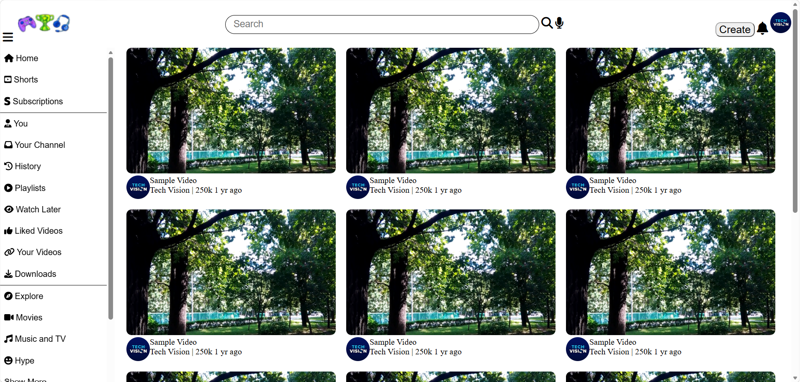

# YouTube Clone 🎬

A responsive YouTube-inspired frontend web application built using **HTML, CSS, and JavaScript**. This project recreates the basic layout and user interface of YouTube, including its navigation bar, sidebar, video thumbnails, video playback page, and interactive elements.

The main goal of this project is to gain practical experience in frontend web development by building a familiar video-sharing platform interface from scratch.




## 📌 About the Project

This YouTube Clone is a frontend development project designed to replicate some of the core visual elements and interactions found on YouTube.

The homepage displays a navigation bar, search bar, sidebar menu, and a collection of video thumbnails. Users can click a thumbnail to navigate to a separate video page, where they can watch a video and interact with buttons such as Like and Dislike.

The project focuses on understanding how HTML structures a webpage, how CSS controls layout and responsiveness, and how JavaScript adds interactivity through DOM manipulation and event listeners.

## ✨ Features

### 1. Navigation Bar

- Navigation bar positioned at the top of the webpage.
- Menu button to toggle the sidebar.
- Logo that links back to the homepage.
- Search bar for a YouTube-inspired interface.
- Profile section with a dropdown menu.

### 2. Sidebar Navigation

- Sidebar containing navigation options.
- Expandable and collapsible sidebar functionality.
- JavaScript-based class toggling to control sidebar visibility.
- Layout adjustments when the sidebar is opened or closed.

### 3. Video Thumbnails

- Video thumbnails displayed on the homepage.
- Video previews arranged in a grid layout.
- Thumbnail links that navigate to the video playback page.
- Channel images and video-related information displayed alongside thumbnails.

### 4. Video Playback Page

- A dedicated page for viewing a selected video.
- HTML5 video player with playback controls.
- Video layout styled using CSS.
- Additional video recommendations displayed alongside the main video on larger screens.

### 5. Like and Dislike Buttons

- Interactive Like and Dislike buttons.
- JavaScript event listeners used to detect button clicks.
- CSS classes used to change the appearance of the selected icons.

### 6. Dropdown Menu

- Dropdown menu associated with the profile section.
- Menu visibility controlled using CSS and JavaScript.
- Interactive elements for navigating between sections.

### 7. Show More and Show Less

- Sidebar content that can be expanded or collapsed.
- JavaScript used to toggle the visibility of additional items.
- Helps keep the sidebar interface organized.

### 8. Responsive Design

- CSS media queries for different screen sizes.
- Adjustments to the layout on smaller screens.
- Sidebar and video recommendations adapted for narrower viewports.
- Flexible sizing to improve the viewing experience across devices.

## 🛠️ Technologies Used

### HTML5

HTML is used to create the structure of the webpage, including the navigation bar, sidebar, video thumbnails, buttons, links, and video player.

### CSS3

CSS is used to style the interface and manage the layout. Flexbox, positioning, transitions, and media queries help create the YouTube-inspired appearance and responsive design.

### JavaScript

JavaScript is used to add interactivity to the webpage. DOM selection, event listeners, and class manipulation control the sidebar, dropdown menu, Like and Dislike buttons, and expandable content.

### Font Awesome

Font Awesome provides icons for interface elements such as the menu, search, Like, Dislike, and profile controls.

## 📂 Project Structure

The project files are organized as follows:

```text
youtube-clone/
├── yt_cloning.html
├── video1.html
├── styles.css
├── logo.png
├── thumbnail.png
└── channel-8.jpeg
```

**File descriptions:**

- `yt_cloning.html` — The main homepage containing the navigation bar, sidebar, and video thumbnails.
- `video1.html` — The video playback page containing the video player, interaction buttons, and related content.
- `styles.css` — The stylesheet containing the layout, colors, spacing, animations, and responsive media queries.
- `logo.png` — The logo image used in the interface.
- `thumbnail.png` — The video thumbnail displayed on the homepage.
- `channel-8.jpeg` — The channel image used alongside video information.

Make sure these filenames match the actual files in your repository. If your logo or other images have different filenames, update this structure accordingly.

## 🚀 Getting Started

Follow these steps to run the project on your computer.

### Prerequisites

You need:

- A modern web browser such as Google Chrome, Microsoft Edge, or Firefox.
- A code editor such as Visual Studio Code.
- Basic familiarity with HTML, CSS, and JavaScript.

### Installation

**Step 1: Clone the repository**

Open a terminal and run the following command, replacing `YOUR_USERNAME` with your GitHub username.

```bash
git clone https://github.com/YOUR_USERNAME/youtube-clone.git
```

**Step 2: Open the project folder**

```bash
cd youtube-clone
```

**Step 3: Open the project**

Open the project folder in your preferred code editor. Make sure the HTML files, CSS file, and image assets are available in the expected locations.

**Step 4: Run the homepage**

Open `yt_cloning.html` in your browser.

You can also use the Live Server extension in Visual Studio Code to run the project through a local development server.

**Step 5: Explore the features**

- Open the sidebar using the menu button.
- Browse the available video thumbnails.
- Click a thumbnail to open the video page.
- Test the video player controls.
- Try the Like and Dislike buttons.
- Explore the dropdown menu and expandable sidebar content.
- Resize the browser window to test the responsive layout.

## 🌐 Deployment

The project can be hosted using **GitHub Pages**, which allows you to share your website through a public URL.

To deploy it:

1. Push your project files to a GitHub repository.
2. Open the repository on GitHub.
3. Navigate to **Settings → Pages**.
4. Under the build and deployment settings, select deployment from a branch.
5. Select your main branch and the root folder.
6. Save the settings and wait for GitHub Pages to publish the website.

For the simplest GitHub Pages setup, consider renaming `yt_cloning.html` to `index.html` so the homepage opens automatically at the root URL. If you keep the existing filename, you may need to open the page using `/yt_cloning.html` at the end of the published URL.

After deployment, test both the homepage and the video page to ensure that navigation, images, stylesheets, and video playback work correctly.

## 📚 What I Learned

Building this project helped me practice several important frontend development concepts:

- Structuring webpages with semantic HTML elements.
- Styling navigation bars, sidebars, buttons, and video layouts with CSS.
- Using Flexbox and CSS positioning to arrange interface components.
- Creating responsive layouts with CSS media queries.
- Selecting HTML elements using JavaScript DOM methods.
- Handling click events with `addEventListener()`.
- Using `classList.toggle()` to switch between CSS classes.
- Connecting multiple HTML pages through hyperlinks.
- Organizing HTML, CSS, and image assets in a project folder.
- Using GitHub to store and share source code.

## 🔮 Future Improvements

The project can be enhanced further by adding features such as:

- Functional search that filters videos by title.
- More video pages with different video content.
- Working navigation links for all sidebar options.
- A persistent Like and Dislike state.
- Improved accessibility through descriptive image alt text and keyboard navigation.
- A more polished responsive layout for mobile devices.
- A video recommendation system based on categories.
- Improved page loading and image optimization.

These improvements can be added gradually as the project develops.

## ⚠️ Limitations

This project is a frontend demonstration and does not implement the complete functionality of the original YouTube platform.

Some interface elements may be visual demonstrations rather than fully functional services. It does not include a backend, user authentication, video uploads, comments stored on a server, or a real recommendation algorithm.

Video playback depends on the availability of the configured video source and a compatible browser.

## 📄 Disclaimer

This project is created for educational and personal learning purposes only. It is inspired by the user interface of YouTube and is not affiliated with, sponsored by, or endorsed by YouTube or Google.

YouTube is a trademark of Google LLC.

## 👨‍💻 Author

Created as a personal frontend web development learning project.

**Technologies:** HTML • CSS • JavaScript

**Project Type:** Frontend Web Development

---

If you find this project useful, feel free to explore the code, learn from it, and build your own improvements.
